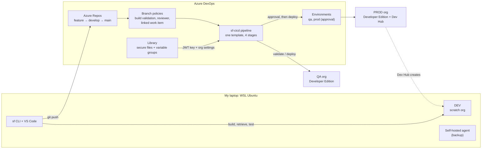
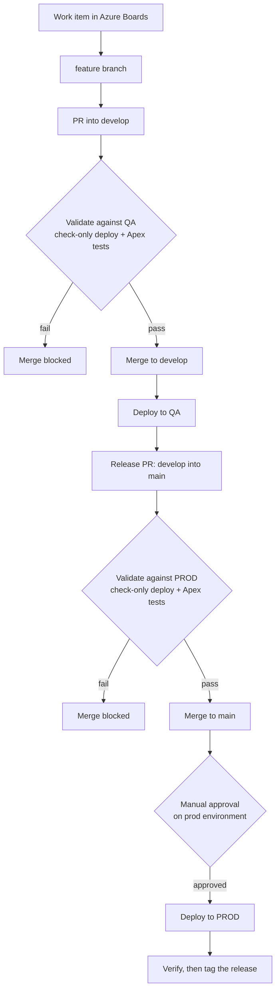

## TL;DR

I built a CI/CD pipeline in **Azure DevOps** that moves **Salesforce** metadata through three environments: **DEV, QA and PROD**.

- Every pull request runs a **check-only deploy plus Apex tests** against the org it is heading to. If it fails, the merge is blocked.
- Merging to `develop` deploys to **QA** automatically.
- Merging to `main` deploys to **PROD**, but only after a **manual approval**.
- The pipeline logs into Salesforce with **JWT** (a private key and a certificate). No passwords live in the repo or in the pipeline.

Then I used it the way a release team would: I shipped two releases, broke a pull request on purpose, caused (and fixed) environment drift in QA, and rolled production back through the pipeline.

%%> [!note] Honest framing This is a **personal project** built on free Salesforce Developer Edition orgs and a free Azure DevOps organization, over one long weekend (Oct 27 to 30, 2026). It is not enterprise work. I came in with **zero Salesforce and zero Azure DevOps experience**. I followed a guided, step by step build, and I wrote these pages afterwards to make sure I actually understand every piece. Part of the point of this write-up is me explaining it to myself.
%%

---

## What I built

### The architecture

The main pieces:

- **DEV** is a **scratch org**: a temporary Salesforce org built from a config file in the repo. I build features there and pull the changes into git.
- **QA** and **PROD** are two free **Developer Edition** orgs. Nobody changes them by hand. Only the pipeline deploys to them.
- **PROD** also acts as the **Dev Hub**, the org that is allowed to create scratch orgs. In a real company the Dev Hub is usually production too.
- **Azure DevOps** holds the code (Repos), the pipeline (Pipelines), the secrets (Library), the deployment targets and approval (Environments) and the work items (Boards).
- The pipeline runs on **Microsoft-hosted agents**. I also registered a **self-hosted agent** on my laptop as a fallback, in case the free hosted minutes ran out.

![[Pasted image 20261027155455.png]] _The Azure DevOps organization already had the free hosted grant: 1 Microsoft-hosted parallel job, 1,800 minutes a month._

### How a change moves through the pipeline

One pipeline, four stages. Each run executes **exactly one** stage, picked by what triggered it:

|What happened|Stage that runs|Target org|
|---|---|---|
|PR into `develop`|Validate (check-only deploy + tests)|QA|
|PR into `main`|Validate (check-only deploy + tests)|PROD|
|Merge to `develop`|Deploy|QA|
|Merge to `main`|**Approval**, then deploy|PROD|

A detail I like: a release PR into `main` is validated against **PROD**, not QA. The change is tested against the org it is actually going to, before anyone approves it.

![[Pasted image 20261029144207.png]] 
_A merge to `develop`: only "Deploy to QA" runs, and the other three stages are skipped by their conditions._

### The three environments

|Environment|What I used|Enterprise equivalent|How it stays in line with PROD|
|---|---|---|---|
|DEV|Scratch org built from `config/project-scratch-def.json`|Scratch orgs or Developer sandboxes|Rebuilt from code, so it is disposable|
|QA|Developer Edition org #2|Partial or Full Copy sandbox|Only the pipeline deploys to it|
|PROD|Developer Edition org #1 (also the Dev Hub)|Production org|Only the pipeline deploys to it, after approval|

Real sandboxes can be refreshed from production. Developer Edition orgs cannot. So in my setup the **"only the pipeline changes QA and PROD"** rule is the entire parity control. Part 7 shows what happened when I broke that rule on purpose.

### The feature being shipped

The Salesforce part is small on purpose. The point is the delivery process, not the app.

- A custom object, `Expense__c`, with Amount, Category, Status and a Requires Approval checkbox.
- An Apex trigger and service class that **flag any expense over $500 for approval**.
- Apex tests with 100% coverage (Salesforce requires at least 75% to deploy to production).
- A permission set, `Expense_Access`, that grants access to the object and fields.

Later releases changed the threshold to $1,000, added a validation rule, and then rolled both back.

---

## Results at a glance

### Releases

|Version|What changed|How it reached PROD|
|---|---|---|
|`v1.0.0`|Expense object, trigger, tests, permission set|Release PR, PROD validation, approval, run `20261029.5`|
|`v1.1.0`|Threshold raised to $1,000, `Category_Required` validation rule|Release PR with an impact section, approval with a comment, run `20261030.5`|
|`v1.1.1`|Rollback of `v1.1.0` (threshold back to $500, validation rule deleted)|Hotfix PR into `main`, PROD validation, approval with a comment|

![[Pasted image 20261030120043.png]] 
_The approval gate before PROD for `v1.1.0`, with the approval comment that records what was verified in QA._

### Problems I hit, and what they taught me

|Problem|Root cause|Lesson|Part|
|---|---|---|---|
|Tests passed in DEV but all 4 failed in QA|Field access came from profile changes that I had (correctly) left out of git|DEV had something QA did not: a parity gap caught by validation, not in production|4|
|PR validation never started|The branch policy pointed at the wrong pipeline, and an existing PR does not pick up new policies until it is updated|Check what a policy is bound to, not just that it is "enabled"|6|
|A change failed PR validation (planned)|The threshold changed but the tests hardcoded the old value|The gate worked: nothing reached QA. Tests should read the rule, not repeat it|7|
|A merge passed validation but the QA deploy failed (planned)|Someone (me) added a validation rule directly in QA, outside git|Drift. The fix goes through git and the pipeline, never through another manual click|7|
|"Redeploy the old version" did not roll back (planned)|Salesforce deploys add and update, they never delete|A real rollback needs a destructive changes manifest|7|

---

## Tools and versions

|Area|Tool|
|---|---|
|Workstation|Windows + WSL Ubuntu 26.04, VS Code with the WSL and Salesforce extensions|
|Salesforce|Salesforce CLI (`sf`) 2.155, API version 68.0, Node.js 24 LTS, OpenJDK 21|
|Salesforce orgs|2 Developer Edition orgs (QA, PROD + Dev Hub), scratch orgs for DEV|
|Source control|Git, Azure Repos, SSH key auth|
|CI/CD|Azure Pipelines (multi-stage YAML, templates), Microsoft-hosted and self-hosted agents|
|Secrets|Azure DevOps secure files and variable groups, Salesforce External Client Apps with JWT bearer flow|
|Release controls|Azure DevOps Environments with approvals, branch policies, Azure Boards|
|Reporting|JUnit test results and Cobertura code coverage published to the pipeline UI|

---

## The series

1. **Overview and architecture** (this page)
2. [[02-foundations|Foundations: orgs, tools and agents]]
3. [[03-source-driven-development|Source-driven development: the SFDX project, Apex and tests]]
4. [[04-environments-and-parity|Environments and parity]]
5. [[05-headless-auth-jwt|Headless auth with JWT and secret storage]]
6. [[06-the-pipeline|The pipeline: YAML templates, policies, QA and PROD]]
7. [[07-release-practice|Release practice: tags, failures, drift and rollback]]
%%8. [[08-lessons-and-enterprise|Lessons learned and what changes in an enterprise SAFe setup]]%%