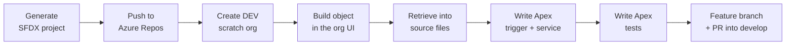
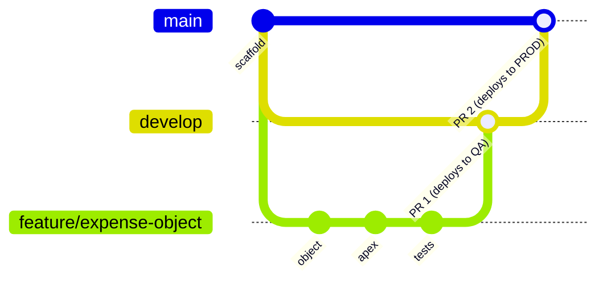

---

Part of the series [[01-overview|Salesforce CI/CD with Azure DevOps]].

**Source-driven development** means git is the source of truth, not the org. Changes are built in a disposable DEV org, pulled into files, committed, reviewed in a pull request, and only then deployed onward. This part builds that loop.



---

## 1. Generate the SFDX project

```bash
cd ~/projects
sf project generate --name sf-cicd-demo --template standard
cd sf-cicd-demo
```

The files that matter:

|File or folder|What it is|
|---|---|
|`sfdx-project.json`|Project manifest: where the source lives (`force-app`) and which API version to use|
|`force-app/main/default/`|All metadata (objects, Apex, permission sets) in **source format**. Everything that gets deployed lives here|
|`config/project-scratch-def.json`|The recipe for a scratch org: edition, features, settings|
|`.forceignore`|Like `.gitignore`, but for the Salesforce CLI. Lists files it will never deploy or retrieve|
|`.gitignore`|Already excludes `.sf/` and `.sfdx/`, which hold local org connection info|

```json
{
  "packageDirectories": [{ "path": "force-app", "default": true }],
  "name": "sf-cicd-demo",
  "namespace": "",
  "sfdcLoginUrl": "https://login.salesforce.com",
  "sourceApiVersion": "67.0"
}
```

`sourceApiVersion` is the Salesforce API version the project's files are written for. It came back in Part 4 as a parity topic.

```bash
git init
git add .
git commit -m "chore: scaffold SFDX project"
```

---

## 2. Connect to Azure Repos over SSH

I used SSH so no password or token is stored in my git config.

```bash
ssh-keygen -t rsa -b 4096 -C "azdo-wsl" -f ~/.ssh/id_rsa_azdo

cat >> ~/.ssh/config <<'EOF'
Host ssh.dev.azure.com
  IdentityFile ~/.ssh/id_rsa_azdo
  IdentitiesOnly yes
EOF
chmod 600 ~/.ssh/config
```

- **RSA, not ed25519:** Azure Repos has historically only accepted RSA keys.
- **A key only for Azure DevOps**, and `IdentitiesOnly yes` so SSH does not try my other keys first (which can cause "too many authentication failures").

I uploaded the **public** key (`.pub`) under **User settings > SSH public keys**:

![[Pasted image 20261027204253.png]]

```bash
ssh -T git@ssh.dev.azure.com
# remote: Shell access is not supported.   <- this means authentication worked
```

The repo was empty, so I copied its SSH clone URL:

![[Pasted image 20261027205019.png]]

```bash
git remote add origin git@ssh.dev.azure.com:v3/hectorproko-sfcicd/sf-cicd-demo/sf-cicd-demo
git push -u origin main

git checkout -b develop
git push -u origin develop
```

### The branching strategy



|Branch|Purpose|Deploys to|
|---|---|---|
|`feature/*`|One change, one branch|Nowhere (validated against QA by its PR)|
|`develop`|Integration branch|QA|
|`main`|What is in production|PROD, after approval|

I made **`develop` the default branch**, so new PRs target it automatically and it is harder to open a feature PR straight into `main` by accident.

![[Pasted image 20261027212453.png]] _`develop` set as the default branch._

---

## 3. Create the DEV scratch org

A **scratch org** is a temporary, empty org. It is my DEV environment.

```bash
sf org create scratch \
  --definition-file config/project-scratch-def.json \
  --alias dev \
  --set-default \
  --duration-days 7 \
  --target-dev-hub prod \
  --wait 10
```

|Flag|What it does|
|---|---|
|`--definition-file`|The recipe file from the repo. Anyone running this command with the same file gets the same kind of org|
|`--target-dev-hub prod`|Asks the PROD org (the Dev Hub) to create it|
|`--set-default`|Makes `dev` the default org. A safety measure: if I forget `--target-org`, commands hit the throwaway org, not QA or PROD|
|`--duration-days 7`|The org deletes itself after 7 days|
|`--wait 10`|Wait up to 10 minutes (it took 11 seconds)|

```
Your scratch org is ready.
│ 🌳 │ DevHub  │ prod │ ...                            │ Connected │
│    │         │ qa   │ ...                            │ Connected │
│ 🍁 │ Scratch │ dev  │ test-nvo0kdpsoyuf@example.com  │ Active    │ 2026-11-04 │
```

🍁 marks the default org. The scratch org gets a generated `@example.com` username. I never log in with a password. `sf org open` opens it already logged in:

![[Pasted image 20261027213757.png]]

---

## 4. Build the object in DEV, then retrieve it into source

**The feature:** a small expense approval object. Expenses over $500 get flagged for approval.

The daily Salesforce developer loop is: **build in the org's UI, then use source tracking to pull exactly what changed into files.** I started a feature branch first, because work never happens directly on `develop`.

```bash
git checkout -b feature/expense-object
```

**The object**, in Setup > Object Manager > Create > Custom Object:

![[Pasted image 20261028084530.png]]

**The fields:**

|Label|Type|Details|
|---|---|---|
|Amount|Currency (16, 2)|Required|
|Category|Picklist|Travel, Meals, Equipment, Other|
|Status|Picklist|Draft, Submitted, Approved, Rejected|
|Requires Approval|Checkbox|Default unchecked (the trigger sets it)|

![[Pasted image 20261028084915.png]]

![[Pasted image 20261028090852.png]] _The four custom fields. The `__c` suffix on API names means "custom"._

**A permission set** for access:

![[Pasted image 20261028091554.png]]

![[Pasted image 20261028091751.png]]

> [!info] Why a permission set and not the profile Deploying an object does not give anyone access to it. Access used to live in **profiles**, but profiles are hard to deploy cleanly between orgs. Current Salesforce practice is to put access in **permission sets**, which deploy cleanly.

### See what changed, then pull it down

```bash
sf project retrieve preview
```

```
Will Retrieve [9] files.
│ Profile       │ Admin                               │
│ Profile       │ B2B Reordering Portal Buyer Profile │
│ Layout        │ Expense__c-Expense Layout           │
│ CustomObject  │ Expense__c                          │
│ CustomField   │ Expense__c.Status__c                │
│ CustomField   │ Expense__c.Amount__c                │
│ CustomField   │ Expense__c.Category__c              │
│ CustomField   │ Expense__c.Requires_Approval__c     │
│ PermissionSet │ Expense_Access                      │
```

**Source tracking** compares the org with my local files and lists every change made in the org. Then:

```bash
sf project retrieve start
```

The first try failed with `Error (TypeError): fetch failed`. That is Node's generic "I could not make the network request" error. It came right after my laptop woke from sleep, so the WSL network was the likely cause. Running it again worked.

### Three problems before the first commit

Reading the retrieved files carefully, instead of committing everything, caught three problems.

**Problem 1: profiles came down.** Saving the fields also changed field access on two profiles, so source tracking pulled both. I did not commit them:

- A profile file in source is only a **partial** profile. Deploying it can quietly overwrite access settings in QA or PROD.
- `B2B Reordering Portal Buyer Profile` only exists because of features turned on in this scratch org. Deploying it to an org without those features fails. That is an **environment parity** problem: the file depends on something other environments do not have.

```bash
rm -r force-app/main/default/profiles
echo "**/profiles/**" >> .forceignore
```

**Problem 2: the tab was missing.** The permission set referenced a tab that was not in source, which would fail the deploy to QA. I created the tab:

![[Pasted image 20261028100901.png]] _The custom object tab for Expenses._

```bash
sf project retrieve start --metadata CustomTab:Expense__c --metadata PermissionSet:Expense_Access
```

**Problem 3: the permission set was too short.** The retrieved file was 9 lines long and only contained `tabSettings`:

```xml
<PermissionSet xmlns="http://soap.sforce.com/2006/04/metadata">
    ...
    <tabSettings>
        <tab>Expense__c</tab>
        <visibility>Visible</visibility>
    </tabSettings>
</PermissionSet>
```

Salesforce writes this XML in alphabetical order by section, so `fieldPermissions` and `objectPermissions` should come **before** `tabSettings`. There was nothing there. The permission set showed the tab but gave **no access** to the object. Anyone assigned it in QA would see a tab they could not use.

I fixed the object and field permissions in the org, retrieved again, and the file now had the right sections:

```xml
    <fieldPermissions>
        <editable>true</editable>
        <field>Expense__c.Category__c</field>
        <readable>true</readable>
    </fieldPermissions>
    ...
    <objectPermissions>
        <allowCreate>true</allowCreate>
        <allowEdit>true</allowEdit>
        <allowRead>true</allowRead>
        <object>Expense__c</object>
        ...
    </objectPermissions>
```

> [!note] Why Amount is missing from fieldPermissions Required fields are always accessible, so Salesforce does not store field permissions for them. That is expected.

**The lesson:** I caught this by **reading the source file**, without deploying anything. Pipelines rely on the same idea: trust what is in git, not what you remember clicking.

Final check, then commit:

```bash
sf project retrieve preview   # "No files will be retrieved." (profiles listed as ignored)
git status -uall
git add .
git commit -m "feat: add Expense__c object, fields, layout, tab and Expense_Access permission set"
```

---

## 5. The Apex trigger and service class

**The rule:** any expense over $500 gets `Requires_Approval__c = true` automatically.

**The pattern:** a **thin trigger** that only hands records to a service class.

- All the logic lives in a normal class, which is easier to test and reuse.
- One trigger per object, so trigger execution order never becomes a problem.

```bash
sf apex generate class --name ExpenseService --output-dir force-app/main/default/classes
sf apex generate trigger --name ExpenseTrigger --sobject Expense__c \
  --event "before insert,before update" --output-dir force-app/main/default/triggers
```

Each command creates the source file plus a `-meta.xml` file (API version and status). Salesforce needs both.

```apex
public with sharing class ExpenseService {
    public static final Decimal APPROVAL_THRESHOLD = 500;

    public static void flagForApproval(List<Expense__c> expenses) {
        for (Expense__c exp : expenses) {
            exp.Requires_Approval__c =
                exp.Amount__c != null && exp.Amount__c > APPROVAL_THRESHOLD;
        }
    }
}
```

```apex
trigger ExpenseTrigger on Expense__c (before insert, before update) {
    ExpenseService.flagForApproval(Trigger.new);
}
```

- **`with sharing`**: the class respects the running user's record access.
- **It takes a list:** triggers process up to 200 records at a time. Writing code for lists is called **bulkification**.
- **`before` trigger:** I change the records in `Trigger.new` directly and Salesforce saves the change. No `update` statement needed.

Deploy to DEV:

```bash
sf project deploy preview   # shows the class and the trigger
sf project deploy start
```

```
Deploying v67.0 metadata to test-...@example.com using the v68.0 SOAP API.
Status: Succeeded
│ Created │ ExpenseService │ ApexClass   │
│ Created │ ExpenseTrigger │ ApexTrigger │
```

### Check it by hand

![[Pasted image 20261028110239.png]] _Amount $600: Requires Approval checked after saving._

![[Pasted image 20261028110251.png]] _Amount $100: stays unchecked._

### Check it from the CLI

Clicking is fine once. I also proved it from the command line with **anonymous Apex**, which is a habit worth keeping for post-deploy checks:

```bash
echo "insert new List<Expense__c>{ new Expense__c(Amount__c=600), new Expense__c(Amount__c=100) };
for (Expense__c e : [SELECT Name, Amount__c, Requires_Approval__c FROM Expense__c ORDER BY CreatedDate DESC LIMIT 2]) System.debug(e);" \
| sf apex run --target-org dev | grep USER_DEBUG
```

```
USER_DEBUG|[2]|DEBUG|Expense__c:{Name=EXP-0003, Amount__c=600.00, Requires_Approval__c=true, ...}
USER_DEBUG|[2]|DEBUG|Expense__c:{Name=EXP-0004, Amount__c=100.00, Requires_Approval__c=false, ...}
```

---

## 6. Apex tests

In Salesforce, tests are not optional. **To deploy Apex to production, at least 75% of the Apex lines must be covered by tests, and every trigger must have some coverage.** The platform enforces it, so tests are a deployment gate.

```bash
sf apex generate class --name ExpenseServiceTest --template ApexUnitTest \
  --output-dir force-app/main/default/classes
```

```apex
@isTest
private class ExpenseServiceTest {

    @isTest
    static void flagsExpenseOverThreshold() {
        Expense__c exp = new Expense__c(Amount__c = 600, Category__c = 'Travel');
        Test.startTest();
        insert exp;
        Test.stopTest();
        exp = [SELECT Requires_Approval__c FROM Expense__c WHERE Id = :exp.Id];
        Assert.isTrue(exp.Requires_Approval__c, 'Expenses over 500 should require approval');
    }

    @isTest
    static void doesNotFlagAtThreshold() { /* exactly 500 should NOT be flagged */ }

    @isTest
    static void reflagsOnUpdate() { /* 100 updated to 700 should be flagged */ }

    @isTest
    static void handlesBulkInsert() { /* 200 records, half over the threshold: expect 100 flagged */ }
}
```

What the four tests cover: the rule itself, the **boundary** at exactly 500, the **update** path, and a **200-record bulk insert** that proves the trigger is bulk-safe.

- **Tests create their own data** and cannot see existing records by default. Everything is rolled back afterwards. So the same test behaves the same in DEV, QA and PROD.
- **`Test.startTest()` / `Test.stopTest()`** give the code under test a fresh set of governor limits (Salesforce's per-transaction resource limits).

```bash
sf project deploy start
sf apex run test --class-names ExpenseServiceTest --code-coverage \
  --result-format human --output-dir test-results --wait 10
```

```
TEST NAME                                     OUTCOME
ExpenseServiceTest.doesNotFlagAtThreshold     Pass
ExpenseServiceTest.flagsExpenseOverThreshold  Pass
ExpenseServiceTest.handlesBulkInsert          Pass
ExpenseServiceTest.reflagsOnUpdate            Pass

CLASSES         PERCENT
ExpenseService  100%
ExpenseTrigger  100%

Outcome              Passed
Tests Ran            4
Org Wide Coverage    100%
```

`--output-dir test-results` also writes a **JUnit XML** file. That is the file the pipeline will publish in Part 6. I kept generated results out of git:

```bash
echo "test-results/" >> .gitignore
```

> [!question] Is 100% coverage good? Coverage is not the goal, **assertions** are. You can hit 100% with tests that never check anything. Every test here asserts a specific result.

---

## 7. Work item, push, and the first pull request

```bash
git push -u origin feature/expense-object
```

**A work item first.** Linking every change to a planned item is how a team traces a release back to the sprint plan.

![[Pasted image 20261028115754.png]] _Issue 16: "Flag expenses over $500 for approval"._

![[Pasted image 20261028120824.png]] _My project used the **Basic** process (Epic > Issue > Task), which is why the work item is an "Issue" and not a "User Story". Agile and Scrum use Features, User Stories and Sprints, which are closer to SAFe. Fine for this project, and a point for Part 8._

**The pull request**, from `feature/expense-object` into `develop`, with the issue linked:

![[Pasted image 20261028120209.png]]

![[Pasted image 20261028121345.png]] _PR !1 open, linked to Issue 16, no merge conflicts._

**I did not merge it.** There was no pipeline yet. In Part 6 this PR becomes the first one the pipeline validates, which is a better story than "I merged it and added CI afterwards".

---

## What I learned

- **Read what you retrieve.** Profiles, a missing tab and an empty permission set were all caught by looking at files before committing.
- **Profiles are a trap** in source-driven Salesforce work. Permission sets are the clean way to ship access.
- **Thin trigger, logic in a class, written for lists.** The standard Apex pattern, and the one that makes testing easy.
- **Tests are a deployment gate in Salesforce**, not just good practice, and assertions matter more than the coverage number.

Next: [[04-environments-and-parity|Part 4: Environments and parity]]