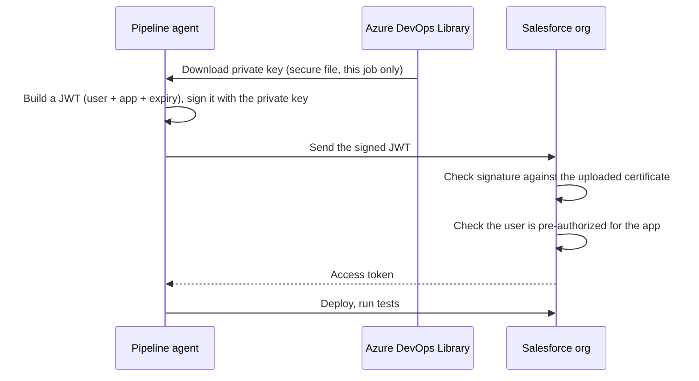

---

Part of the series [[01-overview|Salesforce CI/CD with Azure DevOps]].

On my laptop I logged into the orgs through a browser. A pipeline cannot click "Allow" in a browser, and it should never hold a password. The standard answer for Salesforce is the **OAuth 2.0 JWT bearer flow**.

## How JWT login works



- The pipeline signs a short-lived token with a **private key**.
- Salesforce checks the signature with the **certificate** (the public half) that I uploaded to an app in the org.
- If the signature matches and the user is allowed to use the app, Salesforce returns an access token.
- **No password is ever sent**, and the private key never leaves Azure DevOps.

> [!info] Connected Apps vs External Client Apps Salesforce now recommends **External Client Apps** over the older Connected Apps. One catch in the docs: a Dev Hub that **creates scratch orgs** from a pipeline still needs a Connected App. My pipeline never creates scratch orgs (I decided that in Part 2 because of the 6-per-day limit), so External Client Apps covered everything it does.

---

## 1. A key pair for each environment

**Separate keys per environment** limit the blast radius: if the QA key leaked, it could not be used to log into PROD.

```bash
mkdir -p ~/sf-jwt && chmod 700 ~/sf-jwt && cd ~/sf-jwt

for env in qa prod; do
  openssl req -x509 -newkey rsa:2048 -sha256 -days 365 -nodes \
    -keyout server-$env.key -out server-$env.crt -subj "/CN=sf-cicd-$env"
done
chmod 600 *.key
```

|Part|Meaning|
|---|---|
|`req -x509`|Create a self-signed certificate. Fine here, because Salesforce only uses it to check signatures|
|`-newkey rsa:2048`|Create a new 2048-bit RSA private key|
|`-days 365`|The certificate expires in a year. In an enterprise, that date goes on the runbook: an expired certificate silently breaks every deploy|
|`-nodes`|No passphrase on the key, because a pipeline cannot type one|
|`.key`|The **secret**. Goes to Azure DevOps only|
|`.crt`|**Public**. Gets uploaded to Salesforce|

```
-rw-r--r-- 1 hector hector 1123 Oct 28 14:55 server-prod.crt
-rw------- 1 hector hector 1704 Oct 28 14:55 server-prod.key
-rw-r--r-- 1 hector hector 1115 Oct 28 14:55 server-qa.crt
-rw------- 1 hector hector 1704 Oct 28 14:55 server-qa.key

subject=CN=sf-cicd-qa      notAfter=Oct 28 18:55:23 2027 GMT
subject=CN=sf-cicd-prod    notAfter=Oct 28 18:55:23 2027 GMT
```

Keys are `600` (only I can read them), certificates `644`. The folder is **outside the repo**, so `git add .` can never pick them up. As a second safety net:

```bash
printf '\n# JWT secrets\n*.key\n*.pem\n' >> .gitignore
```

To upload the certificates from the Windows browser, I opened the WSL folder in Explorer:

```bash
explorer.exe "$(wslpath -w ~/sf-jwt)"
```

![[Pasted image 20261028160308.png]]

---

## 2. An External Client App in QA

### A permission set that controls who can use the app

Setup > Permission Sets > New: `CI JWT Access`, then assigned it to my user.

![[Pasted image 20261028161541.png]]

![[Pasted image 20261028161650.png]]

The app will only accept JWT logins for users who have this permission set. Today that is me. In an enterprise it would be a dedicated **integration user**, so deploys do not show up as a real person and do not break when that person leaves the company.

### The app

Setup > App Manager > **New External Client App**:

![[Pasted image 20261028161939.png]]

|Setting|Value|
|---|---|
|Name|`SF CICD Pipeline`|
|Distribution State|Local|
|Enable OAuth|checked|
|Callback URL|`http://localhost:1717/OauthRedirect` (JWT does not use it, but the field is required)|
|OAuth Scopes|`api`, `web`, `refresh_token, offline_access`|
|Flow Enablement|**Enable JWT Bearer Flow**|
|Certificate|`server-qa.crt` (the QA certificate, never a `.key` file)|

### The policies

|Policy|Value|Why|
|---|---|---|
|Permitted Users|**Admin approved users are pre-authorized**|This is what makes JWT work without a browser. Nobody is asked to click "Allow" because an admin already approved who can use the app|
|App Policies|`CI JWT Access` permission set|Only users with it can log in through this app|
|Refresh token|Expires after 90 days|Limits how long any issued token is useful|
|Session timeout|15 minutes|Enough for a deploy|

![[Pasted image 20261028171459.png]]

![[Pasted image 20261028172758.png]] _The app's settings and policies pages._

### The Consumer Key

The app gets a **Consumer Key** (also called the client ID). It identifies the app. Salesforce emails a verification code before showing it.

![[Pasted image 20261028172218.png]]

The consumer key cannot log anyone in by itself, but I treat it as configuration that does not get posted publicly. (That is why the screenshot of the key itself is not on this page.)

---

## 3. Test JWT login to QA from my laptop

Prove the key, the certificate, the app and the permission set work together **before** involving the pipeline. If something were wrong, I would know it is auth, not YAML.

```bash
read -rp "QA consumer key: " SF_QA_CLIENT_ID   # keeps the key out of bash history

sf org login jwt \
  --username <qa-username> \
  --jwt-key-file ~/sf-jwt/server-qa.key \
  --client-id "$SF_QA_CLIENT_ID" \
  --instance-url https://<qa-my-domain>.develop.my.salesforce.com \
  --alias qa-jwt
```

```
Successfully authorized <qa-username> with org ID 00Dbm000016YGO9EAO
```

```bash
sf data query --query "SELECT Name, OrganizationType FROM Organization" --target-org qa-jwt
```

```
│ NAME │ ORGANIZATIONTYPE  │
│ na   │ Developer Edition │
```

No browser opened. That is the "headless" in headless auth.

Common errors, for future me:

|Error|Usual cause|
|---|---|
|`invalid_client_id`|Wrong key, or the app is still propagating (wait 5 to 10 minutes)|
|`user hasn't approved this consumer`|The permission set is not assigned, or not selected in App Policies|
|`invalid signature` / `invalid assertion`|The key does not match the uploaded certificate|
|`audience is invalid`|Wrong `--instance-url`|

---

## 4. Repeat for PROD, plus a negative test

Same steps in PROD: a `CI JWT Access` permission set, an External Client App with **`server-prod.crt`**, the same policies, and its own consumer key. The PROD login and query worked the same way.

Then a **negative test**: try to log into **PROD** with the **QA** key.

```bash
sf org login jwt \
  --username <prod-username> \
  --jwt-key-file ~/sf-jwt/server-qa.key \
  --client-id "$SF_PROD_CLIENT_ID" \
  --instance-url https://<prod-my-domain>.develop.my.salesforce.com \
  --alias should-fail
```

```
Error (JwtGrantError): ... JwtAuthError::Error authenticating with JWT.
Errors encountered:
invalid client credentials
invalid client credentials
...
```

It failed, which is what I wanted. Salesforce rejected a token signed with the QA key because it does not match the certificate on PROD's app. (The repeated lines are the CLI retrying before it gives up.)

> [!tip] Test that the control blocks what it should Setting up separate keys is only half the job. Proving that the QA key **cannot** reach PROD is the evidence.

---

## 5. Store the secrets in Azure DevOps

The pipeline needs four things per environment. Only one is truly secret, so it goes somewhere different from the rest.

|Item|Secret?|Stored in|
|---|---|---|
|Private key (`server-*.key`)|**Yes**|**Secure file**|
|Consumer key|Not really, but no reason to print it|Variable group, **locked**|
|Username|No|Variable group|
|Instance URL|No|Variable group|

### Secure files (the private keys)

**Pipelines > Library > Secure files.** Secure files are encrypted at rest. A pipeline can download one onto the agent **for a single job**, and it is deleted when the job ends. Nobody can download it back out of the UI.

![[Pasted image 20261028183310.png]] _Both keys uploaded as secure files._

![[Pasted image 20261028183543.png]] _Pipeline permissions with **Open access off**: "No permitted pipelines". The first pipeline that tries to use the key has to be explicitly authorized._

### Variable groups (everything else)

Two groups, `sf-qa` and `sf-prod`, with the **same variable names**:

|Name|Value|Locked|
|---|---|---|
|`SF_USERNAME`|the org's username|no|
|`SF_INSTANCE_URL`|the org's My Domain URL|no|
|`SF_CLIENT_ID`|the org's consumer key|**yes** 🔒|
|`SF_KEY_FILE`|`server-qa.key` or `server-prod.key`|no|

![[Pasted image 20261028184618.png]]

- **Same names in both groups** means the pipeline steps for QA and PROD are identical. Only the group changes. That is environment parity inside the pipeline.
- **Locked variables are masked** in logs (shown as `***`).
- **The gotcha:** locked variables are **not** passed to scripts as environment variables automatically. You have to map them explicitly with `env:`. This trips up almost everyone.
- **Open access is off** on both groups too.

> [!note] Rotating a key If a key were ever lost or leaked: generate a new pair, upload the new `.crt` to the app, replace the secure file. Nothing in the pipeline code changes.

---

## 6. An auth-only smoke test pipeline

Before building the real pipeline, I proved that a pipeline agent can log into both orgs. If the real pipeline failed later, auth would already be ruled out. It was also my first Azure Pipelines YAML.

`pipelines/auth-check.yml`, on a branch `ci/auth-check`:

```yaml
trigger: none   # never runs on push
pr: none        # manual only

parameters:
  - name: agentPool
    displayName: Agent pool
    type: string
    default: hosted
    values: [hosted, SelfHosted]

pool:
  ${{ if eq(parameters.agentPool, 'hosted') }}:
    vmImage: ubuntu-latest
  ${{ else }}:
    name: SelfHosted

stages:
  - stage: AuthQA
    variables:
      - group: sf-qa
    jobs:
      - job: auth
        steps:
          - checkout: none
          - task: DownloadSecureFile@1
            name: jwtKey
            inputs:
              secureFile: server-qa.key
          - bash: |
              set -euo pipefail
              command -v sf >/dev/null || npm install --global @salesforce/cli
              sf org login jwt --username "$SF_USERNAME" \
                --jwt-key-file "$(jwtKey.secureFilePath)" \
                --client-id "$SF_CLIENT_ID" \
                --instance-url "$SF_INSTANCE_URL" --alias target
              sf data query --query "SELECT Name, OrganizationType FROM Organization" --target-org target
            displayName: JWT login and query
            env:
              SF_CLIENT_ID: $(SF_CLIENT_ID)
          - bash: sf org logout --target-org target --no-prompt
            displayName: Logout
            condition: always()

  - stage: AuthPROD
    # same as AuthQA, with group sf-prod and secureFile server-prod.key
```

|Piece|Why it is there|
|---|---|
|`parameters` + `${{ if }}`|Pick the agent pool when starting a run. `${{ }}` expressions are evaluated **before** the run starts, so they decide the shape of the pipeline|
|`checkout: none`|This job does not need the repo|
|`DownloadSecureFile@1`|Puts the key on the agent for this job only. `$(jwtKey.secureFilePath)` is its path|
|Key file name written directly|Azure DevOps checks which secure files a pipeline uses **when the run is queued**, to ask for permission. A value from a variable group is not known that early. (The real pipeline passes it as a template parameter instead)|
|`env: SF_CLIENT_ID: $(SF_CLIENT_ID)`|The explicit mapping that locked variables need|
|`command -v sf \| npm install ...`|Install the CLI only if missing. Hosted agents need it; my WSL agent already has it|
|Logout with `condition: always()`|Runs even if a step failed. On my self-hosted agent, without it the PROD login would stay saved on my laptop|

### Register and run it

![[Pasted image 20261028191822.png]] _Saved (not run) as a new pipeline, renamed `auth-check`._

![[Pasted image 20261028193630.png]] _Choosing the agent pool at run time, thanks to the parameter._

The first run stopped right away:

![[Pasted image 20261028192956.png]] _"This pipeline needs permission to access 2 resources before this run can continue." That is the gate from turning Open access off. It is working as intended._

![[Pasted image 20261028203349.png]] _Permitting `server-qa.key` and the `sf-qa` variable group._

![[Pasted image 20261028203821.png]] _AuthQA passed. AuthPROD then asked for permission too._

**Why AuthPROD asked separately:** Azure DevOps checks resource permissions **stage by stage, when each stage is about to start**. Permitting the QA resources said nothing about the PROD ones (`sf-prod` and `server-prod.key`). That is least privilege happening on its own: this pipeline had no access to PROD secrets until a PROD stage ran and I approved it.

![[Pasted image 20261028211042.png]] _Both stages green._

### Same pipeline, self-hosted agent

I ran it again with `SelfHosted`, with `./run.sh` running in a terminal:

![[Pasted image 20261028203200.png]]

```
2026-10-28 23:06:47Z: Agent connect error: The HTTP request timed out after 00:01:40.. Retrying until reconnected.
2026-10-28 23:08:14Z: Agent reconnected.
2026-10-29 00:34:12Z: Running job: auth
2026-10-29 00:34:37Z: Job auth completed with result: Succeeded
2026-10-29 00:34:39Z: Running job: auth
2026-10-29 00:34:58Z: Job auth completed with result: Succeeded
```

(The connect error was the agent losing its connection while the laptop slept. It reconnected on its own.)

**Both runs passed:** hosted (fresh Microsoft VM, CLI installed every time) and self-hosted (my WSL agent, CLI already there). The same pipeline steps worked on two different agents.

---

## What I learned

- **JWT = a signature, not a password.** The private key proves identity; the certificate in Salesforce verifies it; pre-authorization removes the browser.
- **One key per environment**, and a negative test proves they are isolated.
- **Put each secret where it belongs:** keys in secure files, configuration in variable groups, and only lock what should not be printed.
- **Locked variables need `env:`.** Easy to forget, confusing to debug.
- **Open access off** turns the first use of every secret into an explicit approval, per stage.
- **Prove auth separately** before building the real pipeline.

Next: [[06-the-pipeline|Part 6: The pipeline]]