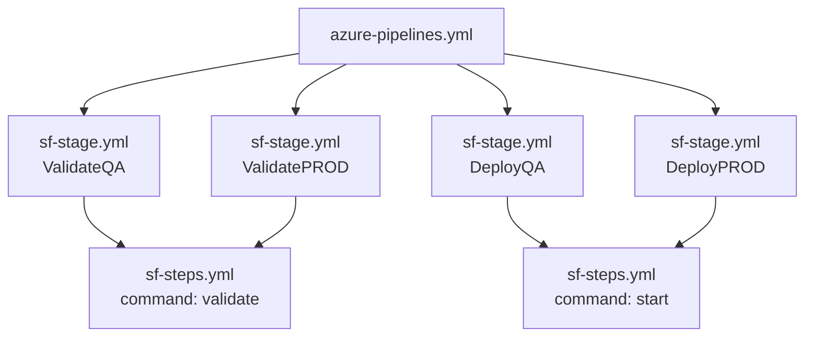

---

Part of the series [[01-overview|Salesforce CI/CD with Azure DevOps]].

Everything before this was preparation. This part builds the real pipeline and ships the first release through it.

## The design

|Event|Stage|Target org|
|---|---|---|
|PR into `develop`|Validate (check-only + tests)|QA|
|PR into `main`|Validate (check-only + tests)|PROD|
|Merge to `develop`|Deploy|QA|
|Merge to `main`|**Approval**, then deploy|PROD|

PRs into `main` validate against **PROD**, not QA. A release is tested against the org it is actually going to, before anyone approves it.

---

## 1. Environments and the PROD approval gate

An Azure DevOps **Environment** is a named deployment target. Pipelines that deploy to one get a **deployment history** ("what went to PROD, when, from which commit"), and you can attach **checks** that must pass before anything deploys there.

**Pipelines > Environments > New environment**: `qa` and `prod`, resource type **None**. Salesforce orgs are not VMs or Kubernetes clusters, so the environment is just a logical target.

![[Pasted image 20261028212324.png]]

On `prod`: **Approvals and checks > Approvals**:

|Setting|Value|
|---|---|
|Approvers|me|
|Instructions|`Confirm QA deploy succeeded and release notes are ready.`|
|Allow approvers to approve their own runs|**checked** (I am the whole team)|
|Timeout|1 day|

![[Pasted image 20261028212510.png]] _The `prod` environment with one approval check._

- The **timeout** means a release cannot sit waiting forever. After it expires, the run fails and has to be started again.
- In an enterprise, the approver would be a release manager or Change Advisory Board, and **self-approval would be off**.
- Other checks worth knowing: **Business hours** (deploys only inside a release window) and **Exclusive lock** (only one run deploys to `prod` at a time).

`qa` has no checks. QA deploys automatically on merge.

---

## 2. The pipeline YAML

Three files, so **every environment is deployed by the same code** with different inputs:

```
azure-pipelines.yml                 <- entry point: triggers + 4 stages
pipelines/templates/sf-stage.yml    <- one stage: a validate job OR a deployment job
pipelines/templates/sf-steps.yml    <- auth, the sf command, publish results, logout
```



If someone asks "how do you keep QA and PROD deploys consistent?", the answer is: **they run the identical template; only the variable group, the key file and the environment change.**

### File 1: `pipelines/templates/sf-steps.yml`

```yaml
parameters:
  - name: keyFile
    type: string
  - name: command        # validate = check-only, start = real deploy
    type: string
    values: [validate, start]

steps:
  - task: DownloadSecureFile@1
    name: jwtKey
    inputs:
      secureFile: ${{ parameters.keyFile }}

  - bash: |
      set -euo pipefail
      command -v sf >/dev/null || npm install --global @salesforce/cli
      sf --version
      sf org login jwt --username "$SF_USERNAME" \
        --jwt-key-file "$(jwtKey.secureFilePath)" \
        --client-id "$SF_CLIENT_ID" \
        --instance-url "$SF_INSTANCE_URL" --alias target
    displayName: Authenticate to Salesforce (JWT)
    env:
      SF_CLIENT_ID: $(SF_CLIENT_ID)

  - bash: |
      set -euo pipefail
      sf project deploy ${{ parameters.command }} \
        --source-dir force-app \
        --target-org target \
        --test-level RunLocalTests \
        --junit --coverage-formatters cobertura \
        --results-dir "$(Build.ArtifactStagingDirectory)/sf-results" \
        --wait 30
    displayName: sf project deploy ${{ parameters.command }}

  - task: PublishTestResults@2
    displayName: Publish Apex test results
    condition: succeededOrFailed()
    inputs:
      testResultsFormat: JUnit
      testResultsFiles: '**/junit.xml'
      searchFolder: $(Build.ArtifactStagingDirectory)/sf-results
      testRunTitle: $(System.StageDisplayName) Apex tests

  - task: PublishCodeCoverageResults@2
    displayName: Publish Apex code coverage
    condition: succeededOrFailed()
    inputs:
      summaryFileLocation: $(Build.ArtifactStagingDirectory)/sf-results/coverage/**/cobertura.xml

  - bash: sf org logout --target-org target --no-prompt || true
    displayName: Logout
    condition: always()
```

- **`${{ parameters.command }}`** is filled in before the run starts, so one step serves both `validate` and `start` (a real deploy).
- **`succeededOrFailed()`** publishes test results even when tests fail. That is exactly when you need to see them.
- **`|| true` on logout:** if login itself failed there is nothing to log out of, and that should not hide the real error.

### File 2: `pipelines/templates/sf-stage.yml`

```yaml
parameters:
  - name: name
    type: string
  - name: displayName
    type: string
  - name: condition
    type: string
  - name: variableGroup
    type: string
  - name: keyFile
    type: string
  - name: action
    type: string
    values: [validate, deploy]
  - name: environment
    type: string
    default: ''

stages:
  - stage: ${{ parameters.name }}
    displayName: ${{ parameters.displayName }}
    dependsOn: []
    condition: ${{ parameters.condition }}
    variables:
      - group: ${{ parameters.variableGroup }}
    jobs:
      - ${{ if eq(parameters.action, 'validate') }}:
        - job: validate
          displayName: Check-only deploy + Apex tests
          steps:
            - checkout: self
            - template: sf-steps.yml
              parameters:
                keyFile: ${{ parameters.keyFile }}
                command: validate
      - ${{ else }}:
        - deployment: deploy
          displayName: Deploy + Apex tests
          environment: ${{ parameters.environment }}
          strategy:
            runOnce:
              deploy:
                steps:
                  - checkout: self
                  - template: sf-steps.yml
                    parameters:
                      keyFile: ${{ parameters.keyFile }}
                      command: start
```

- **`job` vs `deployment`:** a **deployment** job targets an Environment. That is what records deployment history and enforces the PROD approval. A validation deploys nothing, so it is a normal job.
- **`checkout: self`** is required in the deployment job. Deployment jobs do **not** check out the repo by default, a common gotcha.
- **`dependsOn: []`** makes every stage independent. Only its condition decides whether it runs.

### File 3: `azure-pipelines.yml`

```yaml
trigger:
  branches:
    include: [develop, main]

# Azure Repos ignores the pr: keyword. PR validation comes from branch policies.
pr: none

pool:
  vmImage: ubuntu-latest

stages:
  - template: pipelines/templates/sf-stage.yml
    parameters:
      name: ValidateQA
      displayName: Validate against QA (PR into develop)
      condition: and(eq(variables['Build.Reason'], 'PullRequest'), ne(variables['System.PullRequest.TargetBranch'], 'refs/heads/main'))
      variableGroup: sf-qa
      keyFile: server-qa.key
      action: validate

  - template: pipelines/templates/sf-stage.yml
    parameters:
      name: ValidatePROD
      displayName: Validate against PROD (PR into main)
      condition: and(eq(variables['Build.Reason'], 'PullRequest'), eq(variables['System.PullRequest.TargetBranch'], 'refs/heads/main'))
      variableGroup: sf-prod
      keyFile: server-prod.key
      action: validate

  - template: pipelines/templates/sf-stage.yml
    parameters:
      name: DeployQA
      displayName: Deploy to QA (merge to develop)
      condition: and(ne(variables['Build.Reason'], 'PullRequest'), eq(variables['Build.SourceBranch'], 'refs/heads/develop'))
      variableGroup: sf-qa
      keyFile: server-qa.key
      action: deploy
      environment: qa

  - template: pipelines/templates/sf-stage.yml
    parameters:
      name: DeployPROD
      displayName: Deploy to PROD (merge to main, approval required)
      condition: and(ne(variables['Build.Reason'], 'PullRequest'), eq(variables['Build.SourceBranch'], 'refs/heads/main'))
      variableGroup: sf-prod
      keyFile: server-prod.key
      action: deploy
      environment: prod
```

- **Each run executes exactly one stage.** The others show as skipped, and a skipped PROD stage never asks for approval.
- **Conditions are evaluated at runtime**, so they can read `System.PullRequest.TargetBranch`. That is how a PR into `main` validates against PROD.
- **Two kinds of expressions:** `${{ }}` (template time, before the run, shapes the pipeline) and runtime `condition:` (decides what runs).
- If the hosted minutes ran out, changing `pool` to `name: SelfHosted` is the only change needed.

I committed these on the **feature branch**, so PR !1 carried both the metadata and the pipeline that validates it.

---

## 3. Register the pipeline and add branch policies

A YAML file in a repo does nothing on its own. Azure DevOps runs it only once a **pipeline** object points at it.

**Pipelines > New pipeline > Azure Repos Git > Existing YAML file**, path `/azure-pipelines.yml`, then **Save** (not Run), and rename to `sf-cicd`. A manual run on a feature branch would match none of the four conditions and skip everything.

![[Pasted image 20261029101004.png]] _A manual run proves nothing: all four stages skipped due to conditions._

### Branch policies on `develop` and `main`

**Repos > Branches > `...` > Branch policies**:

![[Pasted image 20261028220302.png]]

|Policy|Setting|What it enforces|
|---|---|---|
|Minimum number of reviewers|1, requestors can approve their own changes|Someone reviews every change (solo exception: me)|
|Check for linked work items|Required|**No work item, no merge.** Traceability from release to plan|
|Build validation|`sf-cicd`, automatic, **required**, expires **immediately when the branch is updated**|**The "block merge on failure" rule.** Complete stays disabled until validation passes|

- **Expiration "immediately when develop is updated":** if someone else merges first, my validation is out of date and must run again. That stops two individually valid PRs from breaking each other.
- **Policies also block direct pushes.** After this, `git push origin develop` is rejected. Every change has to come through a PR.

The same policies went on `main`. The pipeline itself decides that PRs into `main` validate against PROD.

### Troubleshooting: PR validation never started

Saving the build validation policy should have started a validation run on PR !1 immediately. Nothing happened. The PR page showed no policies at all, and Complete was not blocked.

I installed the **Azure DevOps CLI** (`az` with the `azure-devops` extension) to look at it directly:

```bash
az repos pr policy list --id 1          # returned []: no policies evaluated on this PR
az repos policy list ...                # policy scope: repository ID and branch matched
git commit --allow-empty -m "chore: re-trigger PR policy evaluation" && git push
az repos pr policy list --id 1          # now policies appeared, with pipelineId: 7
az pipelines show --id 7                # pipeline 7 = auth-check, not sf-cicd
```

**Two causes:**

1. **The policy pointed at the wrong pipeline.** It was bound to `auth-check` (pipeline 7) instead of `sf-cicd` (pipeline 8). Both appear in the same dropdown, and the UI showed the policy as enabled and required, so it looked correct.
2. **An existing PR does not pick up new policies right away.** PR !1 existed before the policies. Azure DevOps did not evaluate them against it until the PR was updated, which is what the empty commit did.

**The fix:**

```bash
az repos policy build update --id 4 --build-definition-id 8   # develop policy -> sf-cicd
az repos pr policy queue ...                                   # start the evaluation
```

The same correction went on the `main` policy:

|Policy ID|PRs into|Runs pipeline|
|---|---|---|
|4|`develop`|8 (`sf-cicd`) ✅|
|8|`main`|8 (`sf-cicd`) ✅|

> [!summary] One line version PR validation never triggered. With the Azure DevOps CLI I found the branch policy was bound to the wrong pipeline, and that existing PRs only evaluate new policies after an update. I rebound the policy and queued the evaluation manually.

The run then asked for permission to use the QA secure file and variable group (the Open access gate from Part 5), and I permitted them.

---

## 4. The first validation: PR !1

![[Pasted image 20261029133709.png]] _Run summary: triggered by the pull request, 100% of tests passed, 100% covered._

![[Pasted image 20261029133730.png]] _Only "Validate against QA" ran. The other three stages were skipped by their conditions._

The branch it built was `refs/pull/1/merge`: a temporary merge commit Azure DevOps creates for a PR. So it validated **exactly what `develop` would look like after the merge**, not just my branch.

![[Pasted image 20261029133801.png]] _The Tests tab: 4 of 4 passed, read from the JUnit file._

![[Pasted image 20261029133951.png]] _The Code Coverage tab: 100%, 2 modules (`ExpenseTrigger` 1/1 line, `ExpenseService` 5/5 lines), read from the Cobertura file._

> [!note] Why the coverage paths say `./no-map/` Salesforce reports coverage by **class name**, not by file path, so Azure DevOps can show percentages but cannot open the source file in the Files tab. That is cosmetic.

![[Pasted image 20261029140604.png]] _QA > Setup > Deployment Status, the Salesforce side of the same story: my failed manual validation from Part 4, then the pipeline's successful validation. In an audit, these rows can be matched to pipeline runs by their deploy IDs._

I could not open QA with `sf org open --target-org qa` at first. The browser login from Part 2 had expired, so I simply logged in again with `sf org login web --alias qa ...`.

### The reviewer policy was wrong too

![[Pasted image 20261029142649.png]] _"At least 2 reviewers must approve" in a one-person organization._

- **Cause:** the policy's default minimum is 2, and I had not changed it when creating the policy.
- **Fix:** minimum 1, with "allow requestors to approve their own changes". In an enterprise, keep 2 or more with self-approval off.

![[Pasted image 20261029140808.png]] _All required checks green: validation passed, work item linked, 1 reviewer approved, no conflicts._

---

## 5. Merge PR !1: the first deploy to QA

![[Pasted image 20261029143853.png]]

|Option|Choice|Why|
|---|---|---|
|Merge type|**Merge (no fast forward)**|Keeps the individual commits and adds a merge commit, so history shows when the feature landed|
|Complete associated work items|checked|Moves Issue 16 to Done|
|Delete source branch|checked|Merged feature branches should not stay around|

The merge is a push to `develop`, so the CI trigger started a new run. It paused once more for permission, this time on the **`qa` environment** (environments have their own pipeline permissions).

![[Pasted image 20261029144207.png]] _Only "Deploy to QA" ran: 1 job, 100% tests passed._

![[Pasted image 20261029144426.png]] _Environments > qa > Deployments: "Merged PR 1" and its run. This is the "what is in QA right now?" answer._

### Smoke test in QA

**Deploying a permission set does not give it to anyone.** Assigning it is a separate step:

```bash
sf org assign permset --name Expense_Access --target-org qa
```

Then a real record:

```bash
echo "Expense__c e = new Expense__c(Amount__c=750, Category__c='Travel'); insert e;
System.debug([SELECT Name, Amount__c, Requires_Approval__c FROM Expense__c WHERE Id = :e.Id]);" \
| sf apex run --target-org qa | grep USER_DEBUG
```

```
USER_DEBUG|[2]|DEBUG|(Expense__c:{Name=EXP-0000, Amount__c=750.00, Requires_Approval__c=true, ...})
```

The trigger works in QA with real data, not just in tests. (Creating a test record in QA is fine. In PROD I only used read-only checks.)

> [!note] A tiny parity gap The QA record is `EXP-0000`, but DEV started at `EXP-0001`. The auto-number starting value does not seem to carry over in a metadata deploy. Harmless here, but exactly the kind of difference worth noticing.

```bash
git checkout develop && git pull
git log --oneline --graph -8
```

```
*   e6de65d (HEAD -> develop, origin/develop) Merged PR 1: feat: Expense object with approval flag
|\
| * b2d4e06 chore: re-trigger PR policy evaluation
| * ee7d393 ci: add multi-stage Salesforce pipeline with shared stage and step templates
| * 6796e4e chore: ignore private key files
| * 7826ab1 fix(test): run tests with Expense_Access permission set so they pass without profile FLS
| * 8240d75 chore: pin sourceApiVersion to 68.0 to match all environments
| * 0c80dff test: add ExpenseServiceTest covering threshold, update and bulk paths
| * e71885d feat: add ExpenseService and ExpenseTrigger to flag expenses over 500
```

---

## 6. The release: `develop` into `main`, approval, PROD

**The release PR:** source `develop`, target `main` (checked carefully, because the default target is `develop`), title `release: v1.0.0 Expense approval flag`, Issue 16 linked (the policy on `main` requires it).

### PROD validation, before anyone approves

![[Pasted image 20261029155537.png]] _Only "Validate against PROD" runs, and it asks for permission to use the PROD secure file and variable group for the first time, as predicted in Part 5._

![[Pasted image 20261029160117.png]] _Check-only deploy and all tests passed against PROD. If PROD had differed from QA in a way that broke the deploy, this is where I would have found out._

![[Pasted image 20261029160312.png]] _Release PR: all checks green, 1 reviewer approved._

![[Pasted image 20261029160409.png]] _Completing the release PR. **"Delete develop after merging" must be unchecked.** Azure DevOps remembers the last choice, and here the source branch is `develop`. Deleting it would break the whole branching strategy._

### The approval gate

![[Pasted image 20261029160614.png]] _The merge to `main` started run `20261029.5`. The last stage, Deploy to PROD, is waiting._

![[Pasted image 20261029160731.png]] _Deploy to PROD waiting on the `prod` environment: first a pipeline permission for the environment, then the approval check._

I reviewed and approved. Deploy to PROD ran. (For this first release I approved without a comment. For the next two I added one, because the comment is the audit record of **why** it was approved.)

### Verify PROD, read-only

```bash
sf org assign permset --name Expense_Access --target-org prod
sf org list metadata --metadata-type ApexClass --target-org prod | grep -i expense
sf data query --query "SELECT COUNT() FROM Expense__c" --target-org prod
```

```
│ Hector Rodriguez │ 2026-10-29 │ ExpenseServiceTest │ ... │ unmanaged │
│ Hector Rodriguez │ 2026-10-29 │ ExpenseService     │ ... │ unmanaged │

Total number of records retrieved: 0.
```

- Both classes exist in PROD, created today. (The trigger is a different metadata type, `ApexTrigger`, so it does not show in this list.)
- `COUNT() = 0` is correct. A deploy moves **metadata**, not data.

Running the verify block a second time printed `Duplicate PermissionSetAssignment`. Not a real failure: the permission set was already assigned. But it shows that a post-deploy runbook step should be safe to run twice (**idempotent**).

```
*   a4813d8 (HEAD -> main, origin/main) Merged PR 2: release: v1.0.0 Expense approval flag
|\
| * e6de65d (origin/develop, develop) Merged PR 1: feat: Expense object with approval flag
```

**The full path:** feature branch, PR 1, `develop` (QA), PR 2, `main` (PROD).

---

## What I learned

- **Templates are the parity mechanism inside the pipeline.** Same steps, different inputs.
- **Branch policies are what make a pipeline a gate.** Without a required build validation policy, a red pipeline is just a suggestion.
- **"Enabled" is not "correct".** The policy looked fine in the UI and pointed at the wrong pipeline. The CLI showed what it was really bound to.
- **Validate against the real target.** PRs into `main` are tested against PROD before anyone approves.
- **Deployment jobs + Environments** give you approvals and a deployment history for free.
- **Post-deploy steps are part of the release:** assign permissions, run a smoke test, verify read-only in PROD.

Next: [[07-release-practice|Part 7: Release practice]]