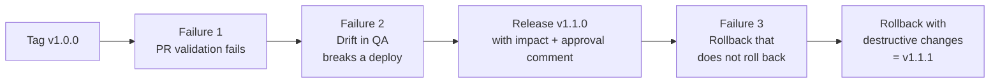

---

Part of the series [[01-overview|Salesforce CI/CD with Azure DevOps]].

A pipeline that only ever goes green proves very little. In this part I used it the way a release team would, including three failures I caused on purpose:



|Failure|Where it was caught|What it cost|
|---|---|---|
|Tests not updated with the code|PR validation|Nothing. No org changed|
|Manual change in QA|QA deploy|QA stuck on the old version until fixed|
|"Redeploy the old version" as rollback|PROD validation|Nothing, because validation caught it first|

---

## 1. Tag v1.0.0

A tag marks the exact commit that went to PROD, so "what is in production?" has a **git** answer, not only a pipeline answer.

First, confirm I am tagging what was actually deployed. Run `20261029.5` built commit `a4813d8`:

```bash
git rev-parse --short HEAD
# a4813d8

git tag -a v1.0.0 -m "v1.0.0: Expense approval flag (Issue 16). Deployed to PROD by sf-cicd run 20261029.5"
git push origin v1.0.0
```

- **`-a` (annotated)** stores who tagged it, when, and a message. A lightweight tag is only a pointer. Releases get annotated tags.
- **Tags are not pushed by `git push`** by default. They are pushed explicitly.
- My `trigger` only lists branches, so pushing a tag does not start a pipeline run.

```
tag v1.0.0
Tagger: Hector Rodriguez <example@gmail.com>

v1.0.0: Expense approval flag (Issue 16). Deployed to PROD by sf-cicd run 20261029.5

commit a4813d8445dde12f994db951eb728ece8b3d3dd0
Merge: e7ba0b7 e6de65d
    Merged PR 2: release: v1.0.0 Expense approval flag
```

Two things I noticed in that output:

1. **`example@gmail.com`**: my git email was still a placeholder from Part 2. Earlier commits keep it; rewriting history for that is not worth it. Once a release tag is published, you never move it.
2. **The PR 2 merge commit description** was placeholder text, now permanent in `main`'s history. Reviewers and auditors read those. The next release PR got a real description.

> [!note] `main` now has a commit `develop` does not The PR 2 merge commit exists only on `main`. That is normal. But it means that any fix made **directly on `main`** (a hotfix) must be **merged back into `develop`**, or the next release will undo it. That comes back in the rollback.

---

## 2. Failure 1: a change that fails PR validation

**Scenario:** the business raises the approval threshold from $500 to $1,000. A developer in a hurry changes the code, forgets the tests, and does not run them locally.

![[Pasted image 20261029173955.png]] _Issue 17 in Azure Boards._

```bash
git checkout develop && git pull
git checkout -b feature/raise-threshold
# ExpenseService.cls: APPROVAL_THRESHOLD = 1000
git commit -am "feat: raise approval threshold to 1000"
git push -u origin feature/raise-threshold
```

**My prediction before the run finished:** the tests use amounts of 600, 500, 100 updated to 700, and a bulk mix of 50 and 900. With a threshold of 1000, anything that expected "over the threshold" to be flagged should fail.

![[Pasted image 20261029175315.png]] _The PR validation run started automatically._

![[Pasted image 20261029175355.png]]

![[Pasted image 20261029175545.png]] _The validate step failed: 3 tests failed, 1 passed._

![[Pasted image 20261029180518.png]] _QA > Deployment Status shows the failed validation. Its ID (`0Afbm00000lkA69`) matches the ID in the pipeline error (`0Afbm00000lkA69CAE`), which connects the two records. QA itself is unchanged, because validation is check-only._

The PR's **Complete** button was blocked by the failed required check. **The gate worked.** A bad change was stopped before it reached any environment.

### The interesting part: the test that passed

`doesNotFlagAtThreshold` **passed**, because $500 is still below $1,000. But it was now testing the **wrong boundary**. A green test is not proof the code is correct, only that this one assertion held.

### The fix: tests that read the rule instead of repeating it

```apex
@isTest
private class ExpenseServiceTest {

    private static final Decimal T = ExpenseService.APPROVAL_THRESHOLD;

    @isTest
    static void thresholdMatchesBusinessRule() {
        Assert.areEqual(1000, ExpenseService.APPROVAL_THRESHOLD,
            'Business rule: expenses above $1000 require approval');
    }

    @isTest
    static void flagsExpenseOverThreshold() {
        System.runAs(userWithExpenseAccess()) {
            Expense__c exp = new Expense__c(Amount__c = T + 1, Category__c = 'Travel');
            ...
            Assert.isTrue(exp.Requires_Approval__c, 'Amount above threshold should require approval');
        }
    }

    @isTest
    static void doesNotFlagAtThreshold() {
        // Amount__c = T, expect NOT flagged
    }

    @isTest
    static void reflagsOnUpdate() {
        // insert at T - 1, update to T + 1, expect flagged
    }

    @isTest
    static void handlesBulkInsert() {
        // 200 records alternating 50 and T + 1, expect 100 flagged
    }
}
```

The fix separates two jobs:

- **Behavior tests** use `T` (the constant), so they keep working if the threshold changes again.
- **`thresholdMatchesBusinessRule`** pins the business value **on purpose**. Changing the rule still requires changing a test, but now it is one deliberate line instead of four accidental failures.

This time I ran the tests **locally first**:

```bash
sf project deploy start --target-org dev
sf apex run test --class-names ExpenseServiceTest --code-coverage --result-format human --wait 10 --target-org dev
```

```
ExpenseServiceTest.doesNotFlagAtThreshold        Pass
ExpenseServiceTest.flagsExpenseOverThreshold     Pass
ExpenseServiceTest.handlesBulkInsert             Pass
ExpenseServiceTest.reflagsOnUpdate               Pass
ExpenseServiceTest.thresholdMatchesBusinessRule  Pass
Tests Ran            5
Pass Rate            100%
```

Pushing re-ran the PR validation automatically, and it went green. **I did not merge yet**, because the next failure needed this PR open.

**Lessons:**

- **Shift left.** The pipeline took a few minutes plus queue time to tell me something a 30-second local test run would have caught. CI is the safety net, not the first check.
- **Assertion messages are documentation.** "Expenses over 500 should require approval" explained the failure instantly, and also became wrong after the change.
- **Failing at validation is cheap.** No org changed, nothing to roll back, nobody waited on an approval.

---

## 3. Failure 2: drift in QA breaks a deploy

**Scenario:** the PR has passed validation against QA. Before it merges, a QA admin "quickly" adds a validation rule directly in the QA org, outside git. The PR is still green, so it merges. Then the **deploy** fails.

This is the most common real-world cause of "it passed validation but failed the deploy", and it is exactly what the "no manual changes in QA or PROD" rule from Part 4 is meant to prevent.

### Create the drift

In the QA org (checking the username in the top right first): Object Manager > Expense > Validation Rules > New.

![[Pasted image 20261030092017.png]] _No validation rules yet._

|Field|Value|
|---|---|
|Rule Name|`Category_Required`|
|Error Condition Formula|`ISBLANK(TEXT(Category__c))`|
|Error Message|`Category is required.`|

(`TEXT()` is needed because Category is a picklist, and `ISBLANK` cannot check a picklist directly.)

![[Pasted image 20261030093039.png]] _The rule, active in QA only._

### Predictions

- **Which test fails?** `handlesBulkInsert`, the only test that creates expenses **without** a Category.
- **Does the PR turn red?** No. The policy only expires when the **`develop` branch** changes. Azure DevOps has no idea the QA **org** changed.

### Merge it

![[Pasted image 20261030094845.png]] _All checks still green, because the validation ran before the drift._

![[Pasted image 20261030094942.png]] _Completing with "Delete feature/raise-threshold" checked. Deleting the source branch is correct here._

![[Pasted image 20261030095334.png]] _Run `20261030.1`, the merge to `develop`: Deploy to QA failed._

![[Pasted image 20261030095426.png]] _The deploy log: `handlesBulkInsert` failed with `FIELD_CUSTOM_VALIDATION_EXCEPTION`, Salesforce's error code for "a validation rule blocked this save". Passing: 4, Failing: 1._

![[Pasted image 20261030095955.png]] _QA > Deployment Status, this time listed as a failed **deploy**, not a validation._

![[Pasted image 20261030100446.png]] _Environments > qa > Deployments: the failed deploy is recorded next to the successful one from PR 1._

**I did not click "Rerun failed jobs".** The org was still drifted, so it would fail the same way. Rerunning without understanding a failure is how teams waste a release window.

### What is in QA right now?

```bash
sf org list metadata --metadata-type ApexClass --target-org qa | grep ExpenseService
```

```
│ Hector Rodriguez │ 2026-10-29 │ ExpenseServiceTest │ ... │ 2026-10-29 │ unmanaged │
│ Hector Rodriguez │ 2026-10-29 │ ExpenseService     │ ... │ 2026-10-29 │ unmanaged │
```

Last modified **yesterday**: the v1.0.0 deploy. QA still runs the **$500** threshold.

- **Salesforce deploys are all-or-nothing.** One failing test rolls back the whole deploy, so QA was never left half-updated.
- But now **`develop` says $1,000 while QA runs $500.** Git and the environment have diverged, and nothing should go to PROD until that is fixed.

### Two ways to resolve drift

|Option|When it is right|
|---|---|
|**A. Remove the rule from QA**|The change was unauthorized or a mistake. Undo it, then rerun|
|**B. Adopt the rule into source**|The rule is a real requirement. Retrieve it into git, fix the tests, send it through a PR|

I chose **B**: requiring a Category is a sensible business rule, and adopting it means DEV, QA and PROD all end up with it. **In both options, the fix goes through git and the pipeline.** A second manual click in QA would just create new drift.

### Adopt the rule into source

![[Pasted image 20261030104710.png]] _Issue 18: "Adopt Category_Required validation rule (QA drift)"._

```bash
git checkout develop && git pull
git checkout -b fix/adopt-category-rule
sf project retrieve start --metadata "ValidationRule:Expense__c.Category_Required" --target-org qa
```

```
│ Created │ Expense__c.Category_Required │ ValidationRule │ force-app/main/default/objects/Expense__c/validationRules/Category_Required.validationRule-meta.xml │
```

Fix the bulk test so every record has a Category:

```apex
expenses.add(new Expense__c(
    Amount__c = Math.mod(i, 2) == 0 ? 50 : T + 1,
    Category__c = 'Other'));
```

And add a test **for the rule itself**. A rule without a test could be deleted and nobody would notice:

```apex
@isTest
static void requiresCategory() {
    System.runAs(userWithExpenseAccess()) {
        try {
            insert new Expense__c(Amount__c = 100);
            Assert.fail('Insert without Category should be blocked');
        } catch (DmlException e) {
            Assert.isTrue(e.getMessage().contains('Category is required'), e.getMessage());
        }
    }
}
```

Locally first (this also deployed the rule to DEV, so all three environments would match):

```
ExpenseServiceTest.requiresCategory              Pass
...
Tests Ran            6
Pass Rate            100%
```

PR into `develop`, linked to Issue 18, with a description saying the rule was found in QA as drift and is being adopted on purpose. Merged, and **Deploy to QA passed**.

### A small lesson about verifying

My first check right after the merge still showed QA classes last modified **2026-10-29**. It looked like the deploy had not worked. Instead of guessing, I asked QA directly:

```bash
echo "System.debug('Threshold in QA: ' + ExpenseService.APPROVAL_THRESHOLD);" \
| sf apex run --target-org qa | grep USER_DEBUG

sf data query --query "SELECT Name, LastModifiedDate FROM ApexClass WHERE Name LIKE 'Expense%'" --target-org qa
```

```
USER_DEBUG|[1]|DEBUG|Threshold in QA: 1000

│ ExpenseService     │ 2026-10-30T15:09:06.000+0000 │
│ ExpenseServiceTest │ 2026-10-30T15:09:06.000+0000 │
```

The deploy finished at 15:09 UTC. My first check ran about a minute **before** that. Nothing was wrong; I was early.

**Lesson:** verify state by **asking the system directly** ("what is the threshold?"), not by inferring from dates and timing. That is what a post-deploy smoke test should be.

**How a real team prevents drift:** remove admin rights in QA and PROD for everyone except the pipeline's integration user, and run a scheduled job that retrieves each org's metadata and diffs it against git.

---

## 4. Release v1.1.0, done properly

**The release PR**, `develop` into `main`, with a real description:

```markdown
## Release v1.1.0

### Changes
- Approval threshold raised from $500 to $1000 (`ExpenseService.APPROVAL_THRESHOLD`)
- New validation rule `Category_Required` on `Expense__c` (adopted from QA drift)
- Tests updated: amounts derived from threshold, new test for the Category rule (6 tests)

### Verified in QA
- Threshold confirmed 1000 via anonymous Apex after deploy
- All 6 Apex tests pass in QA deploy

### Impact
- Existing Expense records without a Category will fail validation on next edit.
  PROD currently has 0 Expense records, so no data impact.

### Rollback
- Revert this merge via PR and redeploy through the pipeline.
```

Both work items linked (Issues 17 and 18).

> [!important] The Impact section This is the part a release manager reads most closely. Adding a validation rule in production can block users from editing their **existing** records. Thinking about that **before** the release is what "release execution" means.

![[Pasted image 20261030114522.png]] _Release PR: "Salesforce validate (PROD)" in progress. No permission prompts this time; they were granted during v1.0.0._

![[Pasted image 20261030114847.png]] _Release PR completed. Merge commit `e29df8c`._

![[Pasted image 20261030115757.png]] _Run `20261030.5`, the merge to `main`._

![[Pasted image 20261030115825.png]] _Deploy to PROD waiting._

![[Pasted image 20261030115904.png]] _"1 approval needs your review before this run can continue to Deploy to PROD."_

![[Pasted image 20261030120043.png]] _The approval, with a comment this time._

The comment I used:

```
QA verified on run 20261030.5: threshold 1000 confirmed via anonymous Apex,
Category_Required active, 6/6 Apex tests passed. PROD validation passed on PR. Releasing v1.1.0.
```

The approval comment is the **audit record of why** the release was approved, attached to the exact run.

![[Pasted image 20261030121113.png]] _Deploy to PROD succeeded._

### Verify, then tag

My first verify ran while the deploy was still waiting and showed `Threshold in PROD: 500` and no validation rule. After the deploy finished:

```bash
echo "System.debug('Threshold in PROD: ' + ExpenseService.APPROVAL_THRESHOLD);" \
| sf apex run --target-org prod | grep USER_DEBUG
sf org list metadata --metadata-type ValidationRule --target-org prod | grep -i category
```

```
USER_DEBUG|[1]|DEBUG|Threshold in PROD: 1000
│ Hector Rodriguez │ 2026-10-30 │ Expense__c.Category_Required │ ... │ unmanaged │
```

`System.debug` only reads a value, so it is safe in production. **Verify first, tag second:**

```bash
git tag -a v1.1.0 -m "v1.1.0: threshold 1000, Category_Required rule. Deployed to PROD by sf-cicd run 20261030.5"
git push origin v1.1.0
git tag -n
```

```
v1.0.0   v1.0.0: Expense approval flag (Issue 16). Deployed to PROD by sf-cicd run 20261029.5
v1.1.0   v1.1.0: threshold 1000, Category_Required rule. Deployed to PROD by sf-cicd run 20261030.5
```

---

## 5. Failure 3: a rollback that does not roll back

**Scenario:** Finance reports that the $1,000 threshold lets large expenses skip approval. They want **v1.0.0 behavior back in PROD now.**

**Salesforce has no "undo deploy" button.** A rollback means deploying older source through the pipeline again.

### A hotfix branch from `main`

A hotfix branches from **`main`** (what is in production), not from `develop` (which may hold unreleased work).

```bash
git checkout main && git pull
git show --no-patch --format="%h %s%nParents: %p" e29df8c
# two parents: it is a merge commit

git checkout -b hotfix/rollback-v1.1.0
git revert -m 1 e29df8c --no-edit
git push -u origin hotfix/rollback-v1.1.0
```

- **`git revert`** creates a **new** commit that undoes the changes. History is not rewritten, so the rollback itself is recorded and auditable.
- **`-m 1`** is needed because it is a merge commit: "keep parent 1 (`main` before the release) and undo what came in from `develop`".

![[Pasted image 20261030123400.png]] _Issue 19: "Roll back v1.1.0: $1000 threshold rejected by Finance"._

### My prediction, and what happened

The revert **deletes** the validation rule's file from source. What does a Salesforce deploy do with a component that exists in the org but is no longer in the source?

![[Pasted image 20261030123804.png]] _The rollback PR's validation failed: 75% of tests passed._

![[Pasted image 20261030123832.png]] _`handlesBulkInsert` (the v1.0.0 version, which sets no Category) failed with `FIELD_CUSTOM_VALIDATION_EXCEPTION`._

**Salesforce deploys only add or update. They never delete.**

- The revert removed `Category_Required` from **git**, but the deploy simply did not mention it, so **the rule stayed in the org**.
- The v1.0.0 bulk test creates expenses without a Category, ran against an org that still had the rule, and failed.
- So **"redeploy the old tag" is not a real rollback** for anything the release **added**. Without explicit deletes, you get a half-rollback: old code with new configuration.

> [!note] An honest detail This first failing run (`refs/pull/6/merge`) validated against **QA**, not PROD: my first rollback PR (!6) targeted `develop`, the default branch, instead of `main`. QA had the same rule, so it showed the same lesson, but against the wrong org. I opened the rollback PR again as **!7 into `main`**, so the real check ran against PROD.

### Teach the pipeline to delete: destructive changes

```bash
mkdir -p manifest
cat > manifest/destructiveChangesPre.xml <<'EOF'
<?xml version="1.0" encoding="UTF-8"?>
<Package xmlns="http://soap.sforce.com/2006/04/metadata">
    <types>
        <members>Expense__c.Category_Required</members>
        <name>ValidationRule</name>
    </types>
    <version>68.0</version>
</Package>
EOF
echo "manifest/package.xml" >> .gitignore
```

- A **destructive changes manifest** lists components the deploy should **delete**.
- **"Pre"** means delete **before** the deploy and tests run, so the tests run in an org without the rule. (A "Post" file deletes after the deploy, for cases where new code must stop referencing something before it can be removed.)
- `package.xml` is ignored because the pipeline generates it on every run.

The deploy step in `sf-steps.yml` became:

```yaml
  - bash: |
      set -euo pipefail
      if [ -f manifest/destructiveChangesPre.xml ]; then
        echo "Destructive changes found:"
        cat manifest/destructiveChangesPre.xml
        sf project generate manifest --source-dir force-app --name package --output-dir manifest
        SCOPE=(--manifest manifest/package.xml --pre-destructive-changes manifest/destructiveChangesPre.xml)
      else
        SCOPE=(--source-dir force-app)
      fi
      sf project deploy ${{ parameters.command }} "${SCOPE[@]}" \
        --target-org target \
        --test-level RunLocalTests \
        --junit --coverage-formatters cobertura \
        --results-dir "$(Build.ArtifactStagingDirectory)/sf-results" \
        --wait 30
    displayName: sf project deploy ${{ parameters.command }}
```

- **If a destructive file exists**, the step generates a `package.xml` from the source and deploys **by manifest**. The destructive options are built around manifest deploys, so that is the reliable combination.
- **Otherwise** it behaves exactly as before.
- It **prints the destructive file into the log.** Deletions should never be invisible.
- `SCOPE=( ... )` is a bash array, which keeps each option as its own argument.

```bash
git add manifest/destructiveChangesPre.xml .gitignore pipelines/templates/sf-steps.yml
git commit -m "fix: delete Category_Required via pre-destructive changes; pipeline supports destructive manifests"
git push
```

![[Pasted image 20261030124454.png]] _Run `20261030.7`, still on PR !6 (so against QA): validation passes once the pre-destructive delete removes the rule first, 100% of tests passed. (The warning is about the `ubuntu-latest` image label changing on Microsoft-hosted agents, not about the deploy.)_

Then the real check, on PR !7 into `main`: **run `20261030.8`, Validate against PROD, succeeded.** PROD still had the rule at that moment, so the v1.0.0 bulk test could only pass because the pre-destructive delete removed it first, in a check-only run. **The rollback was proven against production before anything changed.**

> [!note] Honest note for interviews In a real team, a pipeline change would not ride along with a production hotfix. It would be reviewed and released on its own first. Here they are together because the rollback needed it.

### Ship the rollback, from the CLI

I completed this one with the Azure DevOps CLI:

```bash
az repos pr policy list --id "$PR_ID" \
  --query "[].{policy:configuration.type.displayName, status:status}" -o table
```

```
Policy                       Status
---------------------------  --------
Minimum number of reviewers  approved
Work item linking            approved
Require a merge strategy     approved
Build                        approved
```

```bash
az repos pr update --id "$PR_ID" --status completed \
  --delete-source-branch true \
  --transition-work-items true \
  --query "{pr:pullRequestId, status:status, merge:mergeStatus}" -o table
```

```
Pr    Status     Merge
----  ---------  ---------
7     completed  succeeded
```

Deleting the source branch is safe here, because it is the hotfix branch, not `develop`.

### Finding the right run

My first status check said Deploy to PROD had already **succeeded**, and the PROD verify still showed `1000`. That made no sense, until I looked at **which run** I had queried:

```bash
RUN_ID=$(az pipelines runs list --pipeline-ids "$PIPE_ID" --branch refs/heads/main --top 1 --query "[0].id" -o tsv)
# Run: 40   <- the previous release, not the rollback
```

"Latest run on `main`" returned the **previous** release's run. The rollback run (44) was not listed as the latest yet, because it had not actually started. Querying run 44's timeline, including `Checkpoint` records, showed why: **`Checkpoint.Approval` was `inProgress`**. The run was stopped at the approval gate before the stage could begin.

**Lesson:** find runs by **the exact commit** they built (`sourceVersion`), not by "latest on the branch".

![[Pasted image 20261030130419.png]] _Run 44: "1 approval needs your review before this run can continue to Deploy to PROD"._

![[Pasted image 20261030130510.png]] _Approving the rollback with a comment._

```
Rollback per Finance (Issue 19). PROD validation run 20261030.8 passed: 4/4 tests, Category_Required deletion validated.
```

(Approvals can also be done through the REST API, `_apis/pipelines/approvals`. That is how teams connect approvals to a change management tool like ServiceNow. For a human approval with a comment, the UI is the right tool.)

```bash
az devops invoke --area build --resource timeline \
  --route-parameters project=sf-cicd-demo buildId=44 \
  --query "records[?type=='Stage'].{name:name, state:state, result:result}" -o table
```

```
Name                                               State      Result
-------------------------------------------------  ---------  ---------
Validate against QA (PR into develop)              completed  skipped
Validate against PROD (PR into main)               completed  skipped
Deploy to QA (merge to develop)                    completed  skipped
Deploy to PROD (merge to main, approval required)  completed  succeeded
```

### Verify, then tag v1.1.1

> [!todo] Fill in from my terminal Paste the post-rollback PROD verify output here (expected: `Threshold in PROD: 500` and `Category_Required: not in PROD`), then the `git tag -n` output with `v1.1.1`.

```bash
echo "System.debug('Threshold in PROD: ' + ExpenseService.APPROVAL_THRESHOLD);" \
| sf apex run --target-org prod | grep USER_DEBUG
sf org list metadata --metadata-type ValidationRule --target-org prod | grep -i category || echo "Category_Required: not in PROD"

git checkout main && git pull
git tag -a v1.1.1 -m "v1.1.1: rollback of v1.1.0 (Issue 19). Threshold 500, Category_Required deleted. Deployed to PROD by sf-cicd run <run number>"
git push origin v1.1.1
```

**Why `v1.1.1` and not `v1.0.0` again?** Versions only move forward. PROD now **behaves** like v1.0.0, but it got there through a new release, with its own approval and run. Reusing a tag would erase that history.

### Back-merge into `develop`

The rollback happened on `main`. If `develop` does not get it, **the next release from `develop` would reintroduce the $1,000 threshold and the rule.** So `main` is merged back into `develop`, which also deploys the same destructive change to QA.

```bash
az repos pr create --repository sf-cicd-demo \
  --source-branch main --target-branch develop \
  --title "chore: back-merge v1.1.1 rollback from main into develop" \
  --work-items 19
# validate against QA, approve, complete with --delete-source-branch false (never delete main)
```

Then a **gated parity check** that QA matches PROD:

```bash
THRESH=$(echo "System.debug('T=' + ExpenseService.APPROVAL_THRESHOLD);" | sf apex run --target-org qa | grep -o 'T=[0-9]*' | tail -1)
RULE=$(sf org list metadata --metadata-type ValidationRule --target-org qa 2>/dev/null | grep -c Category_Required || true)
echo "QA  Threshold: $THRESH  Rule count: $RULE"
[ "$THRESH" = "T=500" ] && [ "$RULE" = "0" ] && echo "PARITY OK: QA matches PROD" || echo "PARITY GAP"
```

> [!todo] Fill in from my terminal Paste the back-merge validation result and the output of the parity check here.

---

## 6. Incident note

> [!example] Incident: v1.1.0 rollback (Issue 19) **Summary:** Finance rejected the $1,000 approval threshold released in v1.1.0. PROD was returned to v1.0.0 behavior through the pipeline as v1.1.1.
> 
> **Detection:** a business request, not a technical failure.
> 
> **What went wrong during the response:** reverting the release merge commit and redeploying did not remove the `Category_Required` validation rule, because Salesforce deploys never delete components. The rollback PR's validation failed on the v1.0.0 bulk test. The first rollback PR also targeted `develop` instead of `main`.
> 
> **Resolution:** added a pre-destructive changes manifest to delete the rule, extended the pipeline step to support destructive manifests, validated against PROD (run `20261030.8`), approved with a comment, deployed (run 44), verified, tagged `v1.1.1`, back-merged to `develop`.
> 
> **Impact:** none. Every failure was caught by a check-only validation before PROD changed.
> 
> **Follow-ups:**
> 
> - Every release that **adds** components should ship with its rollback plan, including the destructive manifest it would need.
> - Pipeline changes should be released separately from hotfixes.
> - Find runs by commit SHA, not by "latest on branch".

---

## What I learned

- **Fail early is cheap, fail late is expensive.** Validation failures cost nothing; the drift failure blocked QA; the rollback would have been a half-rollback in PROD without validation.
- **Drift is fixed through git**, never with another manual change.
- **Salesforce deploys never delete.** A real rollback needs destructive changes, and those need to be planned.
- **Hotfixes branch from `main` and must be merged back into `develop`.**
- **Verify by asking the system**, then tag. Tags point at what is actually in production.
- **Approval comments are the audit trail.**

Next: [[08-lessons-and-enterprise|Part 8: Lessons and the enterprise version]]